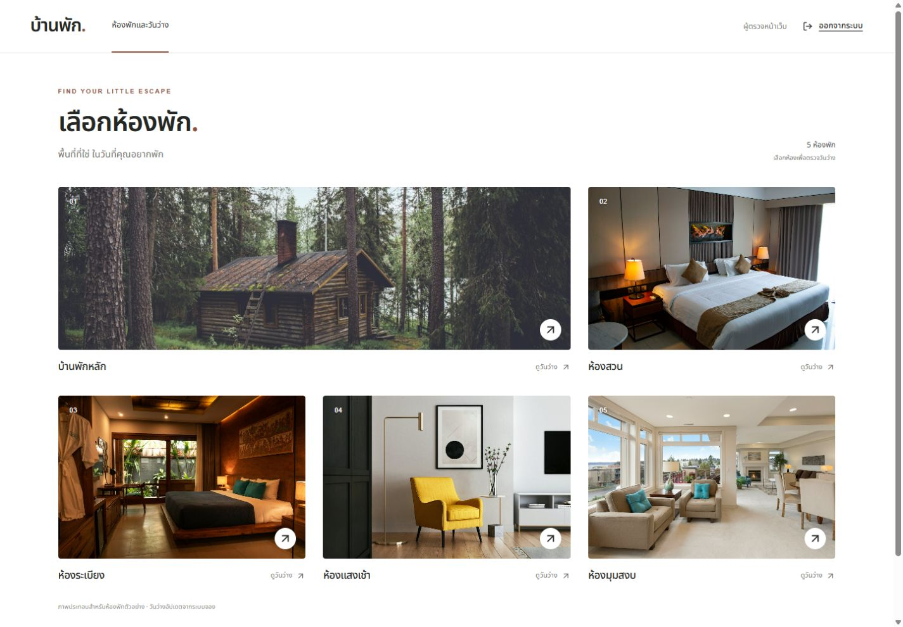

# Booking Frontend

React + TypeScript + Vite สำหรับสมัครสมาชิก เข้าสู่ระบบ เลือกห้อง ดูวันว่าง และจองที่พักผ่าน session cookie

[Backend repository](https://github.com/Tspkp2540/hotel_be) · [Frontend CI](https://github.com/Tspkp2540/frontend/actions/runs/42524975877) · [Integration 27 flows](https://github.com/Tspkp2540/frontend/actions/runs/42525412974)



## ลองใช้งานครบระบบ

ต้องมี Node.js ≥22.18.0, npm, Git และ Docker Linux engine จากโฟลเดอร์ที่ต้องการเก็บงาน:

```sh
git clone https://github.com/Tspkp2540/hotel_be.git hotel-backend
git clone https://github.com/Tspkp2540/frontend.git hotel-frontend
cd hotel-backend
npm ci
npm run build
cd ../hotel-frontend
npm ci
```

เปิดระบบจาก frontend checkout ด้วย PowerShell:

```powershell
$env:BACKEND_DIR = (Resolve-Path ../hotel-backend).Path
npm run dev:system
```

หรือ Bash:

```sh
BACKEND_DIR="$(cd ../hotel-backend && pwd)" npm run dev:system
```

เปิด http://127.0.0.1:3000 แล้วสมัครบัญชีใหม่ มีห้องตัวอย่าง 5 ห้องให้เลือก ใช้ Ctrl+C ปิดระบบและลบฐานข้อมูลชั่วคราว หาก clone คนละตำแหน่งให้ตั้ง BACKEND_DIR เป็น path ของ Backend ที่ build แล้ว ใช้ PREVIEW_PORT เปลี่ยน port ได้

## ตำแหน่งและอายุข้อมูล DB

| วิธีรัน | ข้อมูลอยู่ที่ไหน / เก็บนานแค่ไหน |
|---|---|
| dev:system / test:system | Docker ของเครื่องที่รัน; ลบเมื่อปิดหรือจบรอบ |
| API ที่ผู้ตรวจเตรียมเอง | ฐานข้อมูลตาม DATABASE_URL ของ Backend; ใช้ PostgreSQL/volume ของตัวเองหากต้องการเก็บถาวร |
| GitHub Actions | DB ชั่วคราวบน runner ของ GitHub |

Git มีเฉพาะ source/migrations/seed ไม่รวมบัญชีหรือ bookings ของเครื่องอื่น แต่ละผู้ตรวจสมัครบัญชีของตัวเอง

## ใช้ API ที่เปิดไว้แล้ว

```sh
npm ci
npm run dev
```

Vite proxy ส่ง /api ไป http://127.0.0.1:3001 เปลี่ยนได้ด้วย API_PROXY_TARGET ต้องตั้ง FRONTEND_ORIGIN ของ Backend ให้ตรง origin หน้าเว็บ เช่น http://127.0.0.1:3000 การ build/unit tests ไม่ต้องมี Backend checkout

Production ตั้ง VITE_API_BASE_URL ตาม .env.example ให้ชี้ API ที่อยู่ site เดียวกันผ่าน HTTPS ก่อน npm run build และใช้ static hosting ที่รองรับ SPA fallback

## ตรวจงาน

| คำสั่ง | ผล/หน้าที่ |
|---|---|
| npm run test:coverage | 75 unit/component tests และ coverage gates |
| npm run build | TypeScript และ production bundle |
| npm run test:mutation | 13/13 targeted mutants ในชุดที่กำหนด |
| npm run test:ci-guards | ป้องกัน focused tests ใน CI |
| npm run test:system | Browser integration กับ BACKEND_DIR ที่เลือก |

Windows ใช้ Edge; Linux ติดตั้ง browser ก่อนด้วย npx playwright install --with-deps chromium หากเตรียม API/DB ทดสอบเอง ใช้ BASE_URL และ TEST_DATABASE_URL กับ npm run test:e2e แทน ห้ามชี้ production DB เพราะ tests ล้าง fixtures

[ผลตรวจ/coverage/CI](docs/TESTING.md) · [UI states](docs/STATES.md) · [ภาพ login, popup และมือถือ](docs/PREVIEW.md) · [ที่มาภาพ](ASSETS.md)

## ขอบเขต

การจองใช้วันตาม Asia/Bangkok พักได้ 1–30 คืน วันเข้าล่วงหน้าไม่เกิน 365 วัน Checkout เปิดให้ผู้เข้าพักถัดไปจองต่อได้ ระบบเก็บ request key เพื่อกู้ผลหลัง reload ไม่เก็บ session token หรือ guest fields ใน browser storage ไม่มี payment, admin หรือแก้ไข/ยกเลิกการจอง

src/auth/ session · src/components/ shared UI/calendar/form/recovery · src/lib/ API/types/rules · src/pages/ pages · e2e/ browser tests · scripts/ test runners
