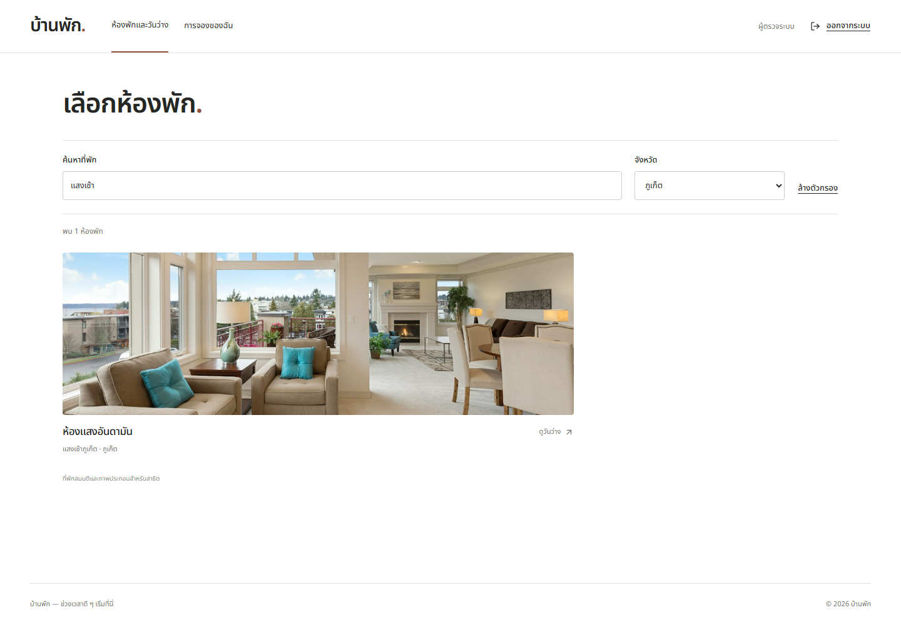

# Booking Frontend

React + TypeScript + Vite สำหรับ [FUNCHZ assignment](https://github.com/FUNCHZ/fullstack-dev-assignment)

[Backend](https://github.com/Tspkp2540/hotel_be) · [Testing](docs/TESTING.md) · [ภาพหน้าจอ](docs/PREVIEW.md) · [UI states](docs/STATES.md)



## เริ่มใช้งาน

ต้องมี Node.js ≥22.18.0, npm, Git และ Docker Linux engine

```sh
git clone https://github.com/Tspkp2540/hotel_be.git hotel-backend
git clone https://github.com/Tspkp2540/frontend.git hotel-frontend
cd hotel-backend
npm ci
npm run build
cd ../hotel-frontend
npm ci
```

เปิดครบระบบจาก Frontend ด้วย PowerShell:

```powershell
$env:BACKEND_DIR = (Resolve-Path ../hotel-backend).Path
npm run dev:system
```

Bash: `BACKEND_DIR="$(cd ../hotel-backend && pwd)" npm run dev:system`

เปิด http://127.0.0.1:3000 แล้วสมัครบัญชี มีโรงแรมสมมติ 8 แห่งใน 8 จังหวัด รวม 12 ห้อง Ctrl+C ปิดระบบและลบฐานข้อมูล preview หากเก็บ Backend คนละตำแหน่งให้ตั้ง BACKEND_DIR เป็น path จริง; ใช้ PREVIEW_PORT เปลี่ยน port

## ฟีเจอร์

- สมัครสมาชิก / login / logout ด้วย session cookie
- ค้นหาชื่อโรงแรม ห้อง หรือจังหวัด และกรองจังหวัด; เก็บตัวกรองใน URL และคงไว้เมื่อกลับจากหน้าห้อง
- เลือกวันว่างและจอง 1–30 คืน ล่วงหน้าไม่เกิน 365 วันตามเวลาไทย
- ดูประวัติของตัวเอง โหลดครั้งละ 20 รายการ และยกเลิกก่อนวันเข้าพัก
- รองรับ loading, empty, error/retry และกู้ผลการจองเมื่อไม่ได้รับคำตอบ
- กรอกเบอร์ไทย 10 หลัก เช่น 0812345678; แปลงเป็น +66 ก่อนส่ง API และแสดงประวัติเป็นเบอร์ไทย
- ข้อผิดพลาดจาก API มี popup หัวข้อ คำอธิบาย และปุ่มตกลง พร้อมเก็บข้อมูลสำหรับแก้ไขหรือลองใหม่
- จองและยกเลิกสำเร็จมี popup ยืนยัน พร้อมใบยืนยันและสถานะในประวัติให้ดูต่อ

ข้อมูลโรงแรม/จังหวัดมาจาก API; ค้นหาแบบ local จาก catalogue ที่โหลดแล้ว วันว่างตรวจที่ปฏิทินและยืนยันอีกครั้งในฐานข้อมูล ภาพใช้ประกอบการสาธิต ดู [ที่มา](ASSETS.md) ไม่มี payment, Admin หรือแก้ไขวันพัก

## ใช้ API ที่เปิดไว้แล้ว

`npm run dev` ใช้ Vite proxy ไป http://127.0.0.1:3001 เปลี่ยนด้วย API_PROXY_TARGET และตั้ง FRONTEND_ORIGIN ของ Backend ให้ตรงหน้าเว็บ

Production ตั้ง VITE_API_BASE_URL ตาม [.env.example](.env.example) ก่อน build ใช้ HTTPS และ static hosting ที่รองรับ SPA fallback

## ตรวจงาน

| คำสั่ง | หน้าที่ |
|---|---|
| npm run format | จัดรูปแบบ source และ tests ด้วย Prettier |
| npm run format:check | ตรวจรูปแบบเดียวกับ CI |
| npm run build | ตรวจ TypeScript และสร้าง production bundle |
| npm run test:coverage | Unit/component tests พร้อม coverage gates |
| npm run test:system | Browser + API + PostgreSQL ของ BACKEND_DIR |
| npm run test:mutation | Targeted mutation catalogue |
| npm run test:ci-guards | ป้องกัน focused tests ใน CI |

Windows ใช้ Edge; Linux ติดตั้ง `npx playwright install --with-deps chromium` ก่อน browser tests ดูผล browser ด้วย `npx playwright show-report` ผลล่าสุดและรายละเอียดอยู่ใน [Testing](docs/TESTING.md)

## ข้อมูลและโครงสร้าง

Preview/tests ใช้ PostgreSQL ชั่วคราวบนเครื่องที่รันและลบเมื่อจบ ต้องการเก็บบัญชี/การจองถาวรให้ใช้ Backend กับ DATABASE_URL และ volume ของตัวเอง Git เก็บ source/migrations/seed ไม่รวมข้อมูลผู้ใช้

src/auth/ session · src/components/ shared UI · src/lib/ API/types/rules · src/pages/ pages · e2e/ browser tests · scripts/ runners
