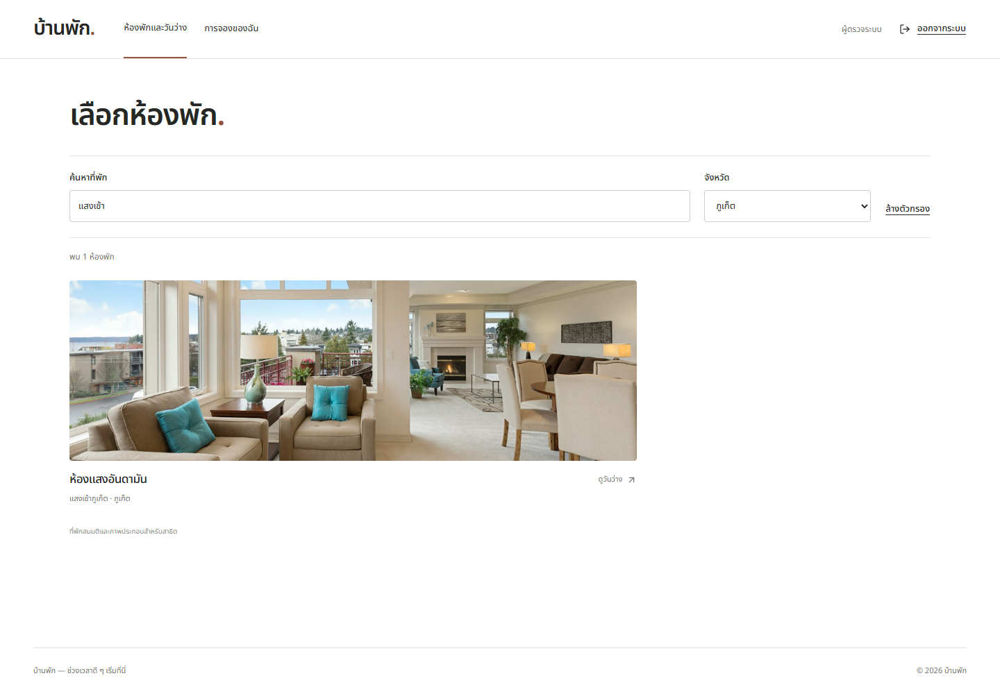
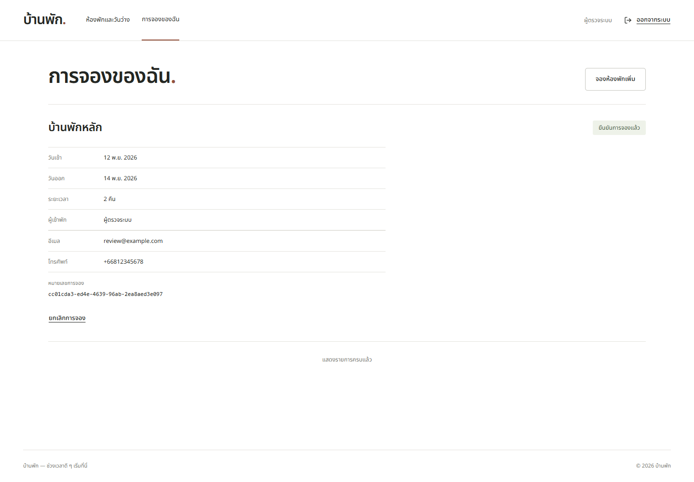
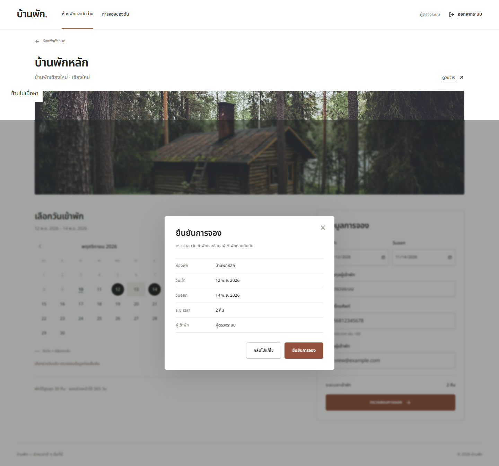
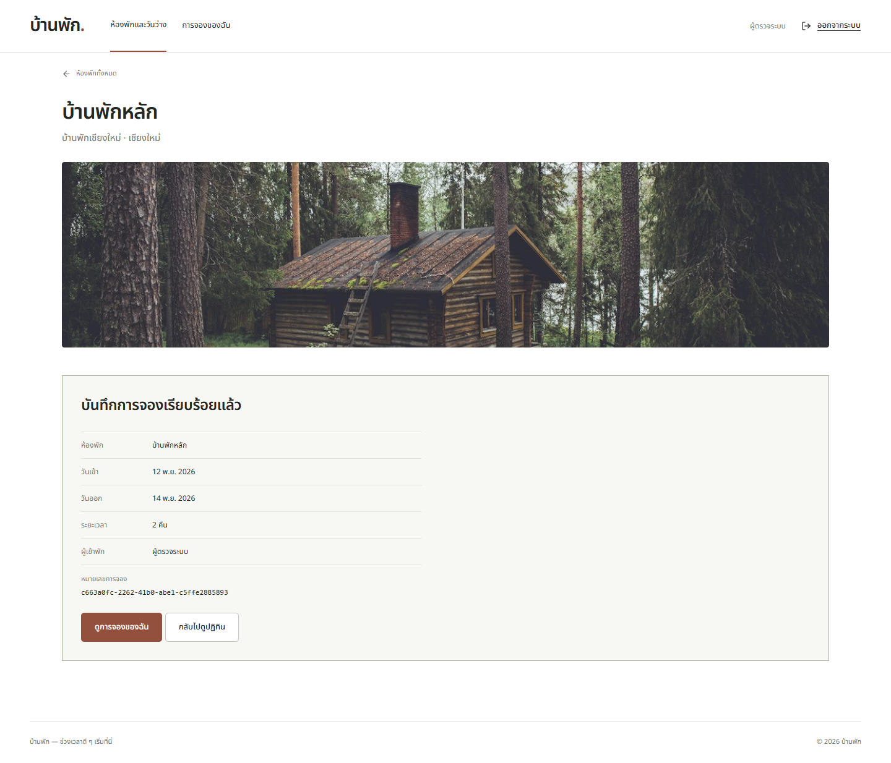
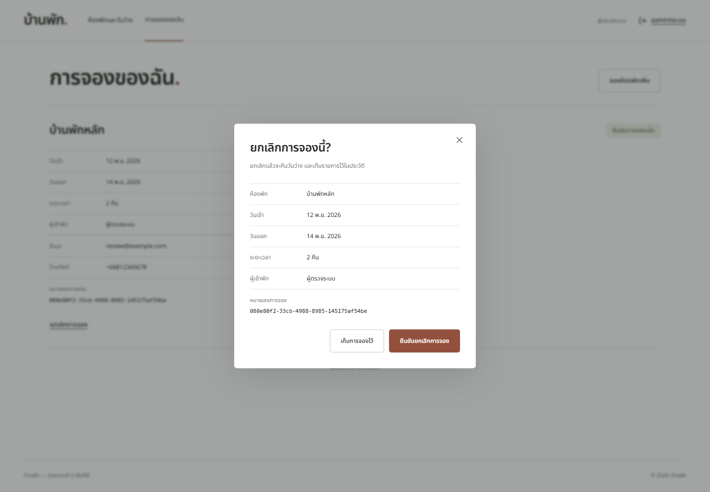
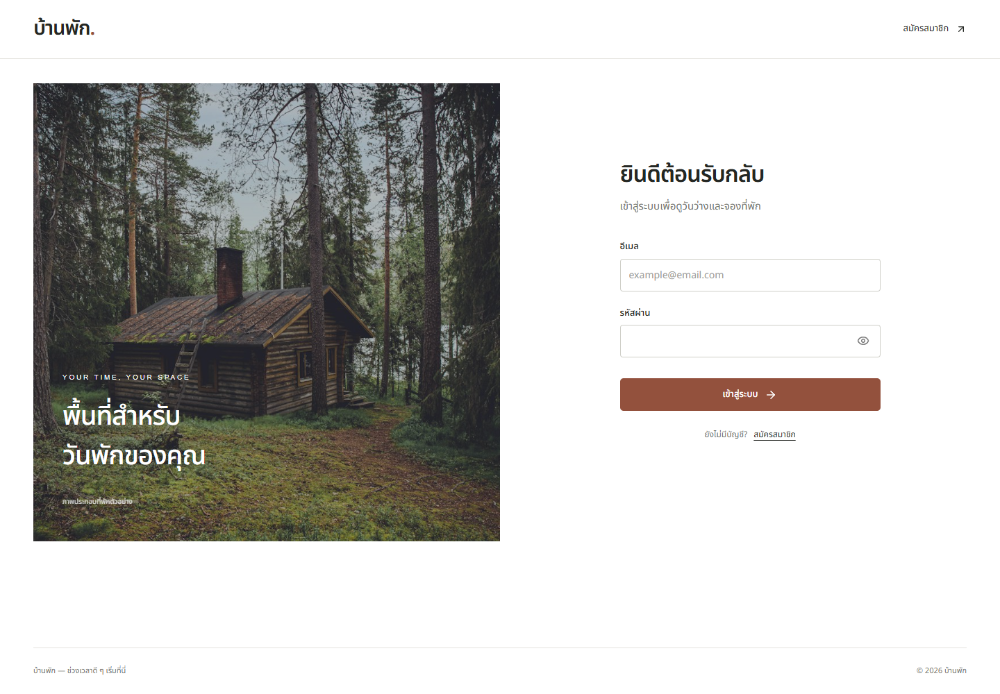
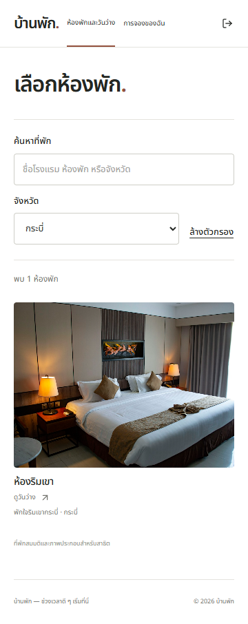

# ภาพหน้าจอ

ภาพจากแอปปัจจุบันด้วยข้อมูลทดสอบ ที่พักเป็นข้อมูลสมมติและใช้ภาพประกอบ [ที่มาภาพ](../ASSETS.md)

## ค้นหาและกรองจังหวัด

## การจองของฉัน

## ยืนยันและผลการจอง

## เข้าสู่ระบบและมือถือ

[README](../README.md) · [States](STATES.md) · [Testing](TESTING.md)
